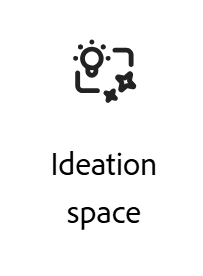

# Adobe Workfront规划构思空间入门

<!--
Should we add a new Feature to ExL for "Strategic Ideation"?
-->

<!--
information in this article come from this document, in addition to my notes for this project up to August 31, 2026:
https://adobe-my.sharepoint.com/:w:/r/personal/alinaw_adobe_com/_layouts/15/Doc.aspx?sourcedoc=%7B513DE769-B70B-4040-8C9E-6A9B8E3167BB%7D&file=getting-started-catalyze.docx&action=default&mobileredirect=true
-->

此页面上的信息引用了尚未公开的功能。 它只能作为&#x200B;**构思空间Beta**&#x200B;程序的一部分提供。\

>[!IMPORTANT]
>
>本文中的信息介绍了Adobe Workfront Planning。 贵公司必须购买附加的Planning包才能访问Workfront Planning。
>
>如果您的组织购买了Workfront Planning作为独立产品，则此处描述的功能将不可用。
>
>有关Workfront Planning的一般信息，请参阅[Adobe Workfront Planning入门](/help/quicksilver/planning/general/planning-overview.md)。
> 
>

<!--
Future - when they make it available in Planning: replace the above with this OR ... insert the snippet:

>[!IMPORTANT]
>
>The information in this article refers to Adobe Workfront Planning which your organization can purchase either as an Adobe Workfront package or a standalone product. 
>
>Not all capabilities included in the Planning package are available to Workfront Planning when it is purchased as a standalone product. 
>
>For general information about Workfront Planning, see [Get started with Adobe Workfront Planning](/help/quicksilver/planning/general/planning-overview.md).
> 
>For information about Workfront Planning as a standalone product, see [Get started with Adobe Workfront Planning as a standalone product](/help/quicksilver/planning/planning-sta/planning-sta-overview.md). 
>
-->

Adobe构思空间是Adobe由AI支持的战略构思功能，直接内置于Workfront Planning中。 它为营销团队提供了一个结构化、基于数据的营销活动策略起点，用基于组织真实绩效历史的AI生成简报取代手动研究和猜测。

该创意空间只能通过Workfront Planning或Workfront主菜单访问，它位于活动生命周期的最前面，处于计划、生产和交付之前，并直接馈送到Workfront Planning工作区，团队可在其中规划和执行其工作。

创意空间可利用Adobe Enterprise CX Coworker生成摘要，以便您稍后可以将其转换为Planning记录或下载为PDF。

## 产品可用性

创意空间的计划发布时间表可能会发生更改，其中包括以下里程碑：

* 面向少量客户的&#x200B;**已关闭的Beta：**&#x200B;已于2026年7月推出。

  生产环境中提供了构思空间供参与客户使用。
* **打开Beta：**，目标日期为2026年11月12日。 这是一项选择加入服务，您必须主动打开该选项，而不是主动选择退出该服务。

  创意空间在“生产”、“预览”和“沙盒”环境中可用，适用于满足所有其他要求的所有客户。

* **正式发布：**&#x200B;计划于2027年2月1日发布。

## 产品要求

<!--section duplicated here: help/quicksilver/planning/ideation/access-needed-to-use-ideation-space.md-->

>[!NOTE]
>
>您无需单独登录即可访问创意空间。 如果您还拥有Workfront Planning，则可以立即将其登录到Workfront。
>
>有关使用构思空间所需访问权限的详细信息，请参阅[使用构思空间所需访问权限](/help/quicksilver/planning/ideation/access-needed-to-use-ideation-space.md)。

如果您的组织和您有权访问以下内容，则可以访问构思空间：

* 云提供商：

  * AWS

    不支持Azure和GCP提供程序。

* 产品：

  * Adobe Workfront与Workfront Planning
  * 适用于Workfront的Adobe Enterprise CX Coworker

    >[!IMPORTANT]
    >
    >Adobe CX Enterprise Coworker当前不适用于医疗、金融或某些其他行业中具有敏感数据的组织。 AI Assistant可供这些组织使用，但构思空间不可用于没有同事的Workfront客户。

* Adobe包：

  * 在开放Beta版本（从2026年11月12日开始）中，您必须满足以下条件：

    * 包含Workfront规划包的Adobe Workfront工作流包

  * 在正式发布版本（计划于2027年2月1日发布）之后，您可以执行以下任一操作：

    * 包含Workfront规划包的Adobe Workfront工作流包
    * Adobe Workfront计划作为独立产品

<!--not required anymore: * Adobe GenStudio for Performance Marketing-->

<!-- only required for closed beta, see below: * Adobe Customer Journey Analytics-->

<!--
No longer required or recommended, per Et:

In addition to above requirements, you must also meet the following criteria to participate in the Closed Beta program: 

* Have an active Adobe Customer Journey Analytics (CJA) account with campaign tracking in place
* Have multi-channel campaigns with a repeatable planning process
* Actively use Workfront Planning for marketing operations
* Have at least one identified strategist or ideation user who will be the primary Ideation space user
-->

## 受众和用例

构思空间专为负责制定营销活动策略和制作营销活动简报的产品和品牌营销人员设计。

<!--
Too much: 

| Role | Primary job to be done |
|---|---|
| Brand Marketer | Identify messaging, trends, and cultural shifts that resonate with target audiences |
| Product Marketer | Launch insight-driven, culturally relevant campaigns that deliver business impact |
| Collaborators | Internal creative studios, external agencies, media planners/managers, and executives who need visibility into strategic direction |
-->

作为工作区管理员，您可以在Workfront Planning中使用构思空间创建记录，步骤如下：

* 在开始创建或编辑记录时，从Planning中启动构思空间后，在其中创建简报。
* 使用AI提示从系统中的其他记录或Web中收集详细信息，并完成创意力简述的创建。
* 从摘要中创建Planning记录类型。
* 在Planning中优化构思简述并更新现有记录类型。

以下是如何使用构思空间的用例：

* **使用历史绩效刷新以前的营销活动**

  * 例如，您可以为新季度、季度或产品时刻更新现有营销活动。
  * 这将生成以先前性能为基础的“增量摘要”，概述保留的内容、更改内容以及原因。

* **使用历史绩效创建新的营销活动**

  * 例如，您可以在启动无直接营销活动历史记录的新产品、区段或计划时创建营销活动。
  * 这通过引导思想、建议的渠道组合以及初始概念或报文方向产生了一个全新的简报。

## 构思空间与Adobe CX Enterprise Coworker

构思空间使用Adobe CX Enterprise Coworker作为其提示界面。

用户可以提出后续问题，并以简短的话语形式进行细化，而不是只获得一次性的结果。

当摘要与Workfront规划实时记录关联时，同事不会覆盖它，因此基础计划保持不变。 仅当将摘要导出到Workfront Planning时，才会覆盖记录。

<!--
Previous intro but oped for the more direct one above: 
The Ideation space is a collaborative strategic marketing ideation tool for brand and product marketers to build stronger campaigns faster and with better team alignment. It grounds AI suggestions in real-marketing context — past briefs, performance data, audience insights, brand guidelines, and existing campaign assets — so results are relevant, not generic.

Ideation space works exclusively with the CX Enterprise Coworker for Workfront as the prompting agent for all its capabilities. 
-->

以下是在构思空间中使用的Co-worker的一些功能：

* 上传文档或社交分析
* 访问与您正在构建的简报相关的Web内容
* 定义营销活动目标
* 获取受众分析摘要
* 生成受众角色
* 构思营销活动消息
* 在大型可视画布中工作，使用AI提示生成文本、图像、文件、图表和insight卡片
* 组织、修订和扩展信息卡，以最终将其转换为营销活动简报
* 与多个用户进行协作，这些用户可以在最终确定简报之前添加创意、对特定画布项目发表评论或针对自由格式创意使用附注
* 建议在创意空间中使用同事时遵循以下最佳实践：

  * **特定**。 更丰富的营销活动描述会产生更相关、更扎实的宣传卡。
  * **在完成**&#x200B;前进行验证。 AI生成的响应可能不准确，因此始终检查卡片上的&#x200B;**源**&#x200B;并根据链接的源进行确认，然后再最终确定记录。
  * **将AI卡与真实记录混合**。 将实际记录拖放到构思空间中。

## 获取对构思空间的访问权限

要访问构思空间，请执行以下操作：

1. 按照本文的[产品要求](#product-requirements)部分所述，验证您是否满足产品要求。
1. 请联系您的Adobe客户代表以表示有兴趣参与封闭Beta，或在开放Beta可用时加入它。

   默认情况下，系统管理员有权访问构思空间，当该构思空间在Open Beta中可用时，无法删除它。 他们可以为所有其他用户将其打开。
1. （推荐）确定您的第一个活动：要刷新的最近活动，或从头开始创建的新计划。

有关使用构思空间的更多信息，另请参阅以下文章：

* [使用构思空间所需的访问权限](/help/quicksilver/planning/ideation/access-needed-to-use-ideation-space.md)
* [从构思空间简报创建计划记录](/help/quicksilver/planning/ideation/create-records-in-ideation-space-for-planning.md)
* [在构思空间中创建简报](/help/quicksilver/planning/ideation/create-briefs-in-ideation-space.md)

## 找到构思空间

在确保您有权访问配置的正确产品、包以及系统和访问级别后，您可以在Workfront的以下区域中找到构思空间：

* 在Workfront Planning中手动添加新记录时

  计划中的
* 在Workfront主菜单中，通过打开构思空间区域

  主菜单中的

>[!TIP]
>
>无法使用布局模板从主菜单中删除创意空间区域。 有关阻止用户访问构思空间的更多信息，请参阅[使用构思空间所需的访问权限](/help/quicksilver/planning/ideation/access-needed-to-use-ideation-space.md)。
>

## 构思空间生成的对象

您可以使用构思空间集思并形成构思，以便稍后将其转换为对您的工作流很重要的项目。

构思空间从内部或外部(Web)来源获取您的所有想法和信息并创建摘要。 确定摘要完成之后，可以将其导出到以下文件或对象：

* 以下文件格式之一：PDF、Word、PowerPoint、Powerpoint模板
* 计划记录

  仅当从Workfront Planning访问构思空间或先前将Planning记录连接到构思摘要时，才能将摘要导出到Planning记录。

<!--
**************** CONSIDER INCLUDING THIS INFORMATION FROM JESH BARLOW ABOUT COWORKER IN CATALYZE?? - https://adobecorpdev.slack.com/archives/C091C0Y735W/p1788917610365089?thread_ts=1788917251.550099&cid=C091C0Y735W

Catalyze Coworker needs — panel inside Catalyze, not a rail from Unified ShellWhy this matters. Catalyze is AI-first. You can't use it without a prompt, so the prompting surface can't be something you open and close from Unified Shell. Coworker's rail was built to bolt onto apps that already work fine without AI. We need the opposite.

What we need

* Coworker embedded as a panel inside Catalyze (the Photoshop/Illustrator model), always present, minimized or expanded, never fully closeable.
* Not the Unified Shell rail that slides in, pushes the app, and only opens and closes from the shell.
* Quick terminology flag, since Coworker inverts it. By "panel" we mean embedded in the app. Their team uses "panel" for the shell version, so we have to be explicit every time.

Must-haves

* Minimized and expanded prompt bar states that live inside Catalyze, not tied to the shell.
* Minimize, never close. There's no state where the prompt disappears.
* Full UI control over how the prompt behaves.
* Headless Coworker so the panel can always sit on the canvas.

Where it stands (Aug 20 Shell/Catalyze sync with Stephen Gould)

* Headless is technically possible. Coworker can be hosted in Catalyze's own front-end.
* But Horia's team has no capacity to build or own an in-app rail. Deeper embedding means Catalyze eng builds the panel and owns it going forward.
* The open question is ownership, one-time integration vs owning the panel long-term. Still unresolved, and it's the thing that decides this.

Worth noting

* Experience Workspace and Brand Visibility (AM) already run Coworker without the shell, so headless isn't net-new. Let's learn how they did it before anyone calls it infeasible.
* Next step everyone agreed on is getting clarity from Horia's team and Joshua on rail ownership.

*************************************
-->

<!--
## Additional resources

* [Adobe Workfront Campaign Planning](https://business.adobe.com/cn/products/workfront/campaign-planning.html)
* [Adobe Workfront Planning documentation](/help/quicksilver/planning/planning-information.md)
* [Adobe GenStudio Overview](https://business.adobe.com/cn/products/genstudio.html)
* [Adobe Customer Journey Analytics](https://business.adobe.com/cn/products/adobe-analytics/customer-journey-analytics.html)

-->

<!--

Not sure if we should disclose this: 

## The problem the Ideation space solves

Before the Ideation space, campaign strategy relied on two slow, manual processes:

- **Gathering insights** — fragmented, time-consuming, and difficult when no prior audience data exists
- **Aligning stakeholders** — without a shared, data-backed "hook," executives, creatives, and channel partners often work from different assumptions, causing rework and delays

The Ideation space automates insight synthesis and generates a structured brief that gives everyone a shared starting point.
-->

<!--
## What's included, phase by phase

| Phase | Timeline | What's included |
|---|---|---|
| Closed Beta | July 2026 | Limited customers/users/campaigns; core agent skills (strategy framing, messaging ideation, audience definition, data ingestion, brief generation); CJA data integration |
| Open Beta | ~Sept 2026 (planned) | Quality/performance improvements; CJA integration refinements; Workfront Planning handoff; data visualization; Planning workspace structure ingestion; Unity/Conversational UI integration |
| General Availability | H2 2026 (planned) | Bring Your Own Data Source (BYODS); Workfront/Workfront Planning data integration; audience data integration; social data integration; workflow ingestion; strategy testing capabilities |

At GA, the Ideation space is also expected to be accessible through the GenStudio Home conversational UI, running as part of Adobe's Agent Orchestrator suite of agents.
-->