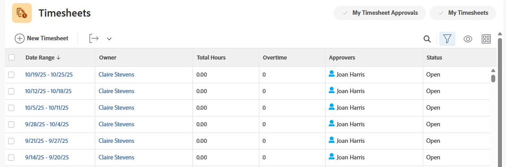

# 编辑工时表信息

作为对时间表具有管理访问权限的用户，您可以在Adobe Workfront中编辑有关现有时间表的信息。 例如，您可以编辑所有者、批准者或时间表的时间范围。

您可以编辑单个时间表上的信息，也可以批量编辑多个时间表。

>[!IMPORTANT]
>
>如果用户与时间表配置文件关联并且时间表是自动生成的，则您对现有时间表进行的更改不会反映在为未来日期生成的时间表中。 所有自动生成的工时表都具有在工时表配置文件中建立的设置。 有关详细信息，请参阅[创建时间表配置文件](../create-and-manage-timesheets/create-timesheet-profiles.md)

## 访问权限要求

+++ 展开可查看本文所述功能的访问权限要求。

<table style="table-layout:auto">
 <col> 
 <col>
 <tbody> 
  <tr> 
   <td>Adobe Workfront 包</td> 
   <td>
“任一”
</td> 
  </tr> 
  <tr> 
   <td>Adobe Workfront许可证</td> 
   <td>
   
标准

   
规划
</td>
  </tr> 
  <tr> 
   <td>访问级别配置</td> 
   <td>
对工时表的管理访问权限
 </td> 
  </tr> 
 </tbody> 
</table>

有关信息，请参阅Workfront文档中的[访问要求](/help/quicksilver/administration-and-setup/add-users/access-levels-and-object-permissions/access-level-requirements-in-documentation.md)。

+++

## 编辑工时表

{{step1-to-timesheets}}

默认情况下，将显示您有权查看的所有时间表。

1. （可选）单击&#x200B;**搜索**&#x200B;图标并键入关键字以搜索特定时间表。 例如，您可以搜索时间表时间范围或所有者名称。

1. （可选）执行以下操作之一以更新时间表列表中的过滤器：

   * 选择页面右上角的&#x200B;**我的工时表批准**&#x200B;以仅查看您批准的时间表，

     或

     选择&#x200B;**我的时间表**&#x200B;以仅查看您的时间表。

     这会将&#x200B;**我的工时表批准**&#x200B;或&#x200B;**我的工时表**&#x200B;筛选器应用到工时表列表。

   * 单击&#x200B;**筛选器**&#x200B;图标以应用筛选器或创建新筛选器。 有关创建或更新筛选器的信息，请参阅[在Adobe Workfront中创建或编辑筛选器](../../reports-and-dashboards/reports/reporting-elements/create-filters.md)。

   >[!NOTE]
   >
   >如果您的Workfront管理员或组管理员从“设置”区域的“列表控件”或您的“布局模板”中删除了筛选器，则“我的时间表审批”和“我的时间表”选项不会显示在时间表列表的顶部或筛选器列表中。 有关详细信息，请参阅[使用布局模板自定义筛选器、视图和分组](../../administration-and-setup/customize-workfront/use-layout-templates/customize-fvg-list-controls-layout-template.md)。

1. （可选）单击&#x200B;**视图** 或&#x200B;**分组** 图标以应用视图或分组或创建新视图或分组。

   有关创建过滤器、视图或分组的信息，请参阅以下文章：

   * [在Adobe Workfront中创建或编辑筛选器](../../reports-and-dashboards/reports/reporting-elements/create-filters.md)
   * [在Adobe Workfront中创建或编辑视图](../../reports-and-dashboards/reports/reporting-elements/create-edit-views.md)
   * [在Adobe Workfront中创建分组](../../reports-and-dashboards/reports/reporting-elements/create-groupings.md)

1. 选择一个或多个时间表，然后单击时间表列表顶部的&#x200B;**编辑**&#x200B;图标。
1. 查看或输入以下信息：

   | 字段名称 | 描述 |
   | --------- | ---------- |
   | 所有者 | 
这是为其创建时间表的用户的名称。 您无法编辑此字段。

当您选择多个时间表时，此字段不显示。
 |
   | 开始日期 | 这是时间表的开始日期。 |
   | 结束日期 | 这是时间表的结束日期。 |
   | 状态 | 
这是时间表的状态。 以下是可能的工时表状态选项：
<ul><li>**打开**：时间表已打开，可以编辑小时条目。</li><li>**已提交**：工时表已提交指定批准者审批。</li><li>**已拒绝**：批准者未批准时间表，该时间表现在再次可供用户编辑时间条目。</li><li>**已关闭**：时间表已被用户关闭或由批准者批准，因此现在已关闭。 您不能向已关闭的工时表添加时间。</li></ul> |
   | 审批者 | 
批准者是批准与时间表关联的用户的时间表的用户。 只有具有时间表管理权限的用户才能设置为批准者。 有关时间表管理权限的详细信息，请参阅[授予用户对特定区域的管理访问权限](/help/quicksilver/administration-and-setup/add-users/configure-and-grant-access/grant-users-admin-access-certain-areas.md)。
 
开始输入时间表批准者的名称，并在他们出现在列表中时选择他们。
 
您在一个时间表上可以有多个批准者。 在这种情况下，在某位批准者批准该时间表后，该时间表将标记为&#x200B;**已关闭**，并从所有剩余批准者的时间表批准列表中消失。
 |
   | 可以编辑时间 | 
如果要允许批准者在时间表上编辑小时数，请选择此选项。

当您选择多个时间表时，此选项不可用。
 |
   | 加班 | 
您可以选择在时间表上隐藏“加班”框。

默认禁用此选项。
 |

1. 单击&#x200B;**保存**。
